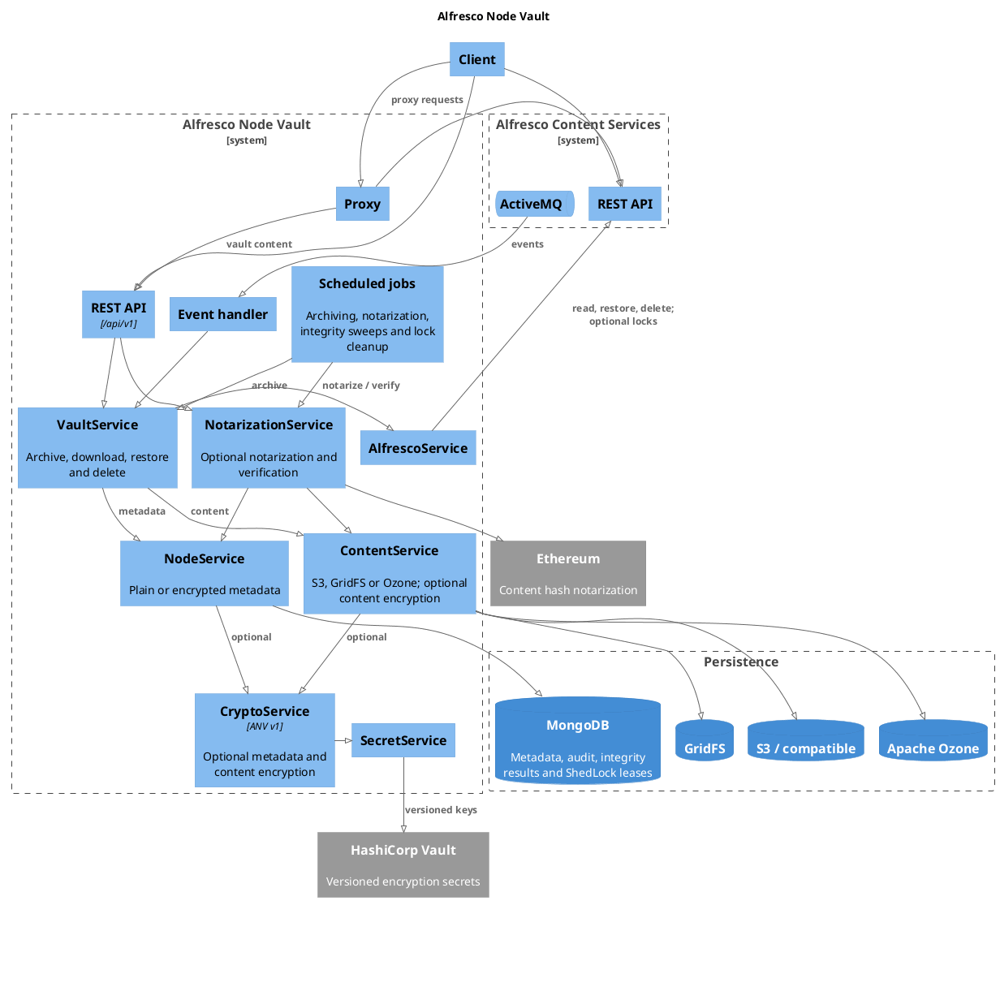

# Alfresco Node Vault


> There once was a document store<br>
> That always required a bit more.<br>
> To open one file,<br>
> You'd wait quite a while,<br>
> Then be billed for waiting some more.

Alfresco Node Vault is an open-source solution for archiving historical documents outside Alfresco,
reducing the active repository while keeping documents accessible through REST APIs and allowing
them to be restored when needed. Designed for administrators and integrators managing growing
repositories, it supports scheduled and on-demand archiving, storing metadata in MongoDB and
content in GridFS, S3 or Apache Ozone. Its Alfresco API proxy helps existing applications retrieve archived
documents, while optional encryption and integrity checks protect the archived data.

[](https://www.gnu.org/licenses/gpl-3.0)
[](https://saidone75.github.io/alfresco-node-vault/javadoc/)


[](https://sonarcloud.io/summary/new_code?id=saidone75_alfresco-node-vault)
[](https://sonarcloud.io/summary/new_code?id=saidone75_alfresco-node-vault)
[](https://sonarcloud.io/summary/new_code?id=saidone75_alfresco-node-vault)

[Features](#key-features) · [Architecture](#architecture) · [Build](#build) · [REST API](#rest-api)

## The Long-term Document Management Challenge

Over time, many Alfresco installations become slower and more difficult to manage as their repositories grow.
The accumulation of millions of documents puts increasing pressure on the database and search index,
slowing down queries and affecting overall system performance.

This situation is particularly common in organizations where:

- Effective corporate policies for archiving or deleting obsolete documents are missing
- Documents are retained indefinitely due to regulatory or compliance obligations
- Repository sizes grow exponentially year after year
- Users experience increasingly long response times in daily operations
- Infrastructure costs continually increase to support ever-larger repositories
- Maintenance operations (backup, indexing, upgrades) become progressively more complex and time-consuming

Repositories with hundreds of millions of documents can require days for complete reindexing operations, or weeks for
migrations during version upgrades.

Many enterprises find themselves in a difficult position: business units demand that all documents remain accessible,
while IT departments struggle to manage increasingly unresponsive Alfresco instances. Technical debt
accumulates, making each upgrade more complex than the last. Site collections become sluggish, search operations time
out, and what was once a highly efficient ECM solution becomes a burden on daily operations.

## The solution: Alfresco Node Vault

Alfresco Node Vault is a Spring Boot application designed for long-term document storage. Archived documents
are removed from Alfresco and its database, freeing resources while keeping those documents accessible.

The application supports on-demand, event-driven and scheduled document archiving.

Document metadata is stored in MongoDB, while content can be stored in GridFS, [AWS S3](doc/S3.md) or [Apache Ozone](doc/Ozone.md),
providing a flexible foundation for long-term storage.

The application can also act as an Alfresco REST API proxy, allowing existing applications to retrieve
archived documents through supported endpoints and maintain access to historical content.

Documents can also be automatically restored to Alfresco when needed.

By implementing Alfresco Node Vault, organizations can:

- Maintain high performance in their active Alfresco repository
- Keep all historical documents accessible when needed
- Significantly reduce backup and maintenance windows
- Lower infrastructure costs by optimizing resource usage
- Simplify upgrade processes by reducing the volume of live data

This approach bridges the gap between complete document purging (often unacceptable for business or compliance reasons)
and the indefinite retention of all documents in the active repository (unsustainable from a performance perspective).

## Key Features

- Lean and elegant code architecture
- Free and open-source software, released under GPL v3 or later
- Scheduled or on-demand archiving
- MongoDB storage for document metadata and the audit trail
- GridFS, [S3](doc/S3.md) or [Apache Ozone](doc/Ozone.md) storage for document content
- Optional blockchain document notarization to provide verifiable evidence of integrity
- Scheduled and on-demand [integrity sweeps](doc/IntegritySweep.md) to verify notarized documents
- Secure and decoupled design that suits zero trust environments
- Optional [strong encryption](doc/Encryption.md) for both content and metadata
- Passwords securely stored in a secret engine
- [REST API](doc/RestApi.md) with Alfresco proxy support and metadata search
- Engineered for flexibility and bespoke integrations
- No Alfresco changes beyond installing the minimal [ANV content model](#alfresco-setup)
- Prometheus monitoring support for metrics and health checks, including [vault operation metrics](doc/Metrics.md)
- Custom upload and download methods
- Minimal memory footprint
- Three selectable Docker JVM runtimes: Azul Zulu, GraalVM Community and IBM Semeru/OpenJ9
- Robust, enterprise-grade reliability and performance

Pull requests are welcome!

## Architecture



## Alfresco setup

Copy [anv-content-model.xml](docker/model/anv-content-model.xml) and
[anv-model-context.xml](docker/model/anv-model-context.xml) to
`<TOMCAT_DIR>/shared/classes/alfresco/extension/` and restart Alfresco. Already included in the Docker stack.

Use `anv:archive` to select documents for scheduled or event-driven archiving; API archiving does not require it.

## Application global config

Global configuration is stored in `application.yml`. The main parameters are:

| Parameter/env variable            | Default value                              | Purpose                                                                                   |
|-----------------------------------|--------------------------------------------|-------------------------------------------------------------------------------------------|
| ALFRESCO_BASE_PATH                | http://localhost:8080                      | Scheme, host and port of the Alfresco server                                              |
| ALFRESCO_USERNAME                 | admin                                      | Alfresco user                                                                             |
| ALFRESCO_PASSWORD                 | admin                                      | Password for the Alfresco user                                                            |
| CONNECTION_TIMEOUT                | 10000                                      | Connect timeout (ms) for Alfresco content streams                                         |
| READ_TIMEOUT                      | 60000                                      | Timeout (ms) of each read from an Alfresco content stream                                 |
| SHARED_FILES_PATH                 | ${java.io.tmpdir}/anv (/tmp/anv in Docker) | Temporary files directory; emptied at startup, one per instance                           |
| ACTIVE_MQ_URL                     | tcp://localhost:61616                      | ActiveMQ broker URL                                                                       |
| MONGODB_URL                       | mongodb://localhost:27017                  | MongoDB connection string                                                                 |
| VAULT_STORAGE_IMPL                | s3                                         | Content storage backend: s3, gridfs or ozone                                              |
| S3_ENDPOINT                       | http://localhost:5000                      | S3 object storage endpoint                                                                |
| S3_KEY                            | testing                                    | Key for S3 authentication                                                                 |
| S3_SECRET                         | testing                                    | Secret for S3 authentication                                                              |
| OZONE_OM_ADDRESS                  | localhost:9862                             | Ozone Manager RPC address (ozone-om:9862 in the Docker stack)                             |
| OZONE_CLIENT_BUFFER_SIZE          | 1MB                                        | Ozone client stream buffer size                                                           |
| OZONE_CLIENT_BUFFER_FLUSH_SIZE    | 2MB                                        | Ozone client stream buffer flush threshold                                                |
| OZONE_CLIENT_BUFFER_MAX_SIZE      | 4MB                                        | Maximum Ozone client stream buffer size                                                   |
| NODE_LOCK_CLEANUP_ENABLED         | true                                       | Remove node locks expired for at least one hour                                           |
| NODE_LOCK_CLEANUP_CRON_EXPRESSION | 0 0 * * * ?                                | Node lock cleanup cron (hourly by default)                                                |
| EVENT_HANDLER_ENABLED             | false                                      | Event based archive behaviour switch                                                      |
| ARCHIVING_JOB_ENABLED             | true                                       | Archiving scheduled job switch                                                            |
| ARCHIVING_JOB_SCHEDULING_MODE     | cron (fixed-delay in dev/docker)           | Archiving schedule: cron or fixed-delay                                                   |
| ARCHIVING_JOB_FIXED_DELAY         | 10s                                        | Delay after each archiving run in fixed-delay mode                                        |
| ARCHIVING_JOB_CRON_EXPRESSION     | 0 0/5 2-6 * * ?                            | Scheduled job cron expression                                                             |
| ARCHIVING_JOB_QUERY               | TYPE:'cm:content' AND ASPECT:'anv:archive' | Query for selecting documents to be archived                                              |
| VAULT_OPERATION_METRICS_ENABLED   | true                                       | Export operation counters, duration histograms and archived bytes                         |
| VAULT_HASH_ALGORITHM              | SHA-256                                    | Hash stored as content metadata in GridFS, S3 or Ozone                                    |
| VAULT_DOUBLE_CHECK                | true                                       | Download the archived document again from Alfresco and the vault and compare their hashes |
| VAULT_DELETE_ON_ALFRESCO          | true                                       | Delete the document from Alfresco after archiving                                         |
| VAULT_ALFRESCO_USE_LOCK           | false                                      | Lock the source in Alfresco throughout archiving, verification and deletion               |
| VAULT_ALFRESCO_LOCK_TTL_SECONDS   | 120                                        | Source lock TTL (minimum 30 seconds), renewed every third of the TTL                      |
| VAULT_ALFRESCO_LOCK_LIFETIME      | PERSISTENT                                 | Source lock lifetime: PERSISTENT or EPHEMERAL                                             |
| VAULT_DELETE_NODE_API_ENABLED     | false                                      | Enable the delete node API                                                                |
| VAULT_READERS_GROUPS               | GROUP_ANV_READERS                           | Comma-separated Alfresco group IDs; membership in any group grants read access; administrators always have access |
| VAULT_AUTH_CACHE_TTL              | 60s                                        | Cache duration of successful API authentications                                          |
| VAULT_ENCRYPT_CONTENT             | false                                      | Enable binary content encryption (S3, GridFS, Ozone)                                      |
| VAULT_ENCRYPT_METADATA            | false                                      | Enable document metadata encryption in MongoDB                                            |
| VAULT_URL                         | http://localhost:8200                      | Vault secret engine URI                                                                   |
| VAULT_ENCRYPTION_KV_MOUNT         | secret                                     | Vault secret engine mount path                                                            |
| VAULT_ENCRYPTION_SECRET_PATH      | AlfrescoNodeVault                          | Path of encryption secret in Vault secret engine                                          |
| VAULT_ENCRYPTION_SECRET_KEY       | anv.secret                                 | Key name of encryption secret                                                             |
| AUDIT_TTL_DAYS                    | 60                                         | Retention of audit entries in days                                                        |
| NOTARIZATION_ENABLED              | true                                       | Enable notarization service                                                               |
| NOTARIZATION_JOB_ENABLED          | false                                      | Document notarization job switch                                                          |
| NOTARIZATION_JOB_CRON_EXPRESSION  | 0 0/5 * * * ?                              | Cron expression for notarization job                                                      |
| INTEGRITY_SWEEP_ENABLED           | false                                      | Enable scheduled integrity sweep job                                                      |
| INTEGRITY_SWEEP_CRON_EXPRESSION   | 0 0 2 * * ?                                | Cron expression for integrity sweep job                                                   |
| INTEGRITY_SWEEP_BATCH_SIZE        | 200                                        | Number of notarized documents processed per sweep page                                    |
| ETH_RPC_URL                       | http://localhost:8545                      | Ethereum RPC endpoint                                                                     |
| ETH_PRIVATE_KEY                   | 4f3edf983ac636a65a842ce7c78d9aa7...        | Private key used to sign transactions                                                     |

Transfer checksums verify document integrity before source deletion, not for cryptographic purposes.
`VAULT_HASH_ALGORITHM` defaults to SHA-256 and also applies to optional blockchain notarization.
Archive verification uses the checksum algorithm recorded with the stored content.

Archiving checks content size and, with `VAULT_DOUBLE_CHECK=true`, hashes before saving metadata;
verification failures trigger rollback. Existing vault copies are always verified before source deletion.

S3 and Ozone stage uploads, with optional encryption, in temporary files; allow space for concurrent
uploads in `SHARED_FILES_PATH`. `READ_TIMEOUT` applies per read, not per transfer.

Integrity sweeps distinguish corrupted nodes from operational errors, which preserve previous verdicts;
nodes deleted during a sweep are skipped. See [Integrity Sweep](doc/IntegritySweep.md).

The Ozone development stack runs without authentication. Secured clusters require
Hadoop/Ozone security configuration and a Kerberos identity; see [Ozone configuration](doc/Ozone.md).

## Build

Java 21 or later and Maven are required. See [CONTRIBUTING.md](CONTRIBUTING.md) for setup instructions.

`mvn package -DskipTests -Dlicense.skip=true`

To create a distribution package, run the build script for your platform:

```bash
./build.sh      # Linux / macOS
```

```bat
build.bat       # Windows
```

The script creates an `anv/` directory containing the versioned `anv-<version>.jar` together with
`config/` and `log/` folders.

## Testing

For a containerized check of archiving, downloading and restoring on S3 and GridFS, with and without encryption,
run `./smoke-tests.sh` (Linux/macOS) or `smoke-tests.bat` (Windows).
S3 is the default; use `--s3`, `--gridfs` or `--ozone` to select a backend, or `--all` to test all three.
These [end-to-end smoke tests](doc/SmokeTest.md) check content hashes and restore retries in an isolated Docker stack.
The launchers stop the smoke stack afterwards; pass `--keep-running` to leave it active for inspection.

The development launcher `vault.sh` also defaults to S3 (Moto). Select the backend with:

```bash
./vault.sh start --s3
./vault.sh start --gridfs
./vault.sh start --ozone
```

`./vault.sh stop` removes all containers in the development Compose project, including
backend services from previous runs, while retaining data volumes. No backend flag is needed.
Use the matching backend flag for `tail`, `build_start` and `purge`.
The optional `novault` argument still starts only infrastructure.
Stop the current stack before switching backend. Switching does not migrate existing content.
`purge --ozone` also removes the managed Ozone data volumes.
These backend flags apply to `vault.sh`; `vault.bat` retains its existing S3 configuration.

To rebuild and recreate only the vault, leaving other services untouched, use:

```bash
./update-vault.sh
```

Select the Docker JVM runtime in `docker/.env` with `VAULT_JVM_RUNTIME`: `zulu` (default), `graalvm` or `semeru`.

For integration tests, start the required containers, then select the matching Maven profile:

| Development stack | Integration tests |
|-------------------|-------------------|
| `./vault.sh start --s3` | `mvn test -Ps3` (or `mvn test`, the default) |
| `./vault.sh start --gridfs` | `mvn test -Pgridfs` |
| `./vault.sh start --ozone` | `mvn test -Pozone` |

The profiles configure the application started by the tests; they do not start Docker services.
Use one storage profile at a time. Load tests use the same profile, for example
`mvn test -Pozone -Dtests=massive`.

Cleanup is enabled by default and removes only nodes created by the tests.
To retain test data, add `-Dtest.cleanup.enabled=false`, for example:

```bash
mvn test -Pozone -Dtest.cleanup.enabled=false
```

This setting applies to Maven integration tests; smoke tests manage their own cleanup.

Native Ozone tests on the host require access to the Docker bridge network, as on a local Linux
Docker Engine. See [Ozone.md](doc/Ozone.md#tests) for networking requirements.
On Windows, `vault.bat` starts S3; use `mvn test -Ps3`.

## Concurrent operations

ShedLock with MongoDB coordinates node operations and background jobs across instances.
See [concurrency](doc/Concurrency.md) for configuration and limitations.

Set `VAULT_ALFRESCO_USE_LOCK=true` to lock the source in Alfresco throughout archiving and deletion.
Locks default to `PERSISTENT`, with a renewed 120-second TTL.
Use a dedicated Alfresco account, since the lock owner can still modify the document.

## Docker configuration

The helper scripts explicitly load `docker/.env` for Docker Compose interpolation.
Edit that file to adjust development image versions, or export the corresponding
variables in the shell before running `vault.sh` (shell values take precedence).
A `docker/.env.local` file is not loaded automatically. When invoking Compose
manually, pass override files explicitly with `--env-file`, after `docker/.env`,
and use the same Compose files as the launcher for your backend.

Key variables include:

- `ACS_IMAGE` – Alfresco Content Services image name
- `MONGO_IMAGE` – MongoDB image name
- `HASHICORP_VAULT_IMAGE` – HashiCorp Vault image name
- `VAULT_JVM_RUNTIME` – `zulu` (default), `graalvm` or `semeru`; rebuild the vault image after changing it

The development stack runs HashiCorp Vault in nonpersistent dev mode. Restarting it loses
all secret versions; the provisioner recreates only the initial development secret. Documents
encrypted with rotated versions become unreadable even if MongoDB and content storage retain
them. Use a persistent Vault deployment and retain required key versions for durable encrypted archives.

For local development you may rely on the defaults, while in
production you will likely point to hardened images or custom deployments.

## Run

Use Java 21 or later. Start Alfresco, MongoDB, ActiveMQ and the selected content backend first;
Ethereum is needed when notarization is enabled (the default). For local infrastructure, use
`./vault.sh start novault` (or `vault.bat start novault` on Windows).

```bash
cd anv
java -jar anv-VERSION.jar
# Replace VERSION with the version in the generated filename.
```

The application listens on port `8086` and uses the `dev` profile by default; override it with
`SPRING_PROFILES_ACTIVE`. Configure service endpoints and credentials in `config/application.yml`
or through the documented environment variables. The default `spring.config.import: vault://`
also requires HashiCorp Vault when encryption is disabled; configure its address and authentication
under `spring.cloud.vault`.

All `/actuator/**` endpoints use separate Basic credentials, defaulting to `admin` / `admin`.
Configure them with `management.security.basic-auth.username` and `.password`; these are independent
of Alfresco API credentials.

## REST API

The REST API is versioned under `/api/v1` and requires HTTP Basic authentication against Alfresco.
Alfresco administrators can use all APIs. Members of any group listed in `VAULT_READERS_GROUPS` can search and read archived metadata and content.
The default is `GROUP_ANV_READERS` (the Alfresco group `ANV_READERS`).
All other APIs, including audit, require administrator credentials. The API roots are:

- `/api/v1/vault` to search, retrieve, archive, restore, notarize and re-encrypt documents and to run integrity sweeps
- `/api/v1/audit` to read the audit trail

The vault currently does not preserve Alfresco ACLs for document access: administrators and members of the
configured reader groups can consult **all** archived documents, regardless of their original permissions.
Stored permission metadata can optionally be used during restore; it is not enforced when reading from the vault.
Create the reader groups in Alfresco and assign their members explicitly; the application does not create them.
In Docker, set `VAULT_READERS_GROUPS` in `docker/.env` and recreate the vault to configure a comma-separated list, for example `GROUP_ANV_READERS,GROUP_ARCHIVISTS`.

The two supported Alfresco proxy GET routes use the same vault reader authorization for archived documents;
other requests are forwarded to Alfresco and use its authorization rules. The OpenAPI documentation
served at `/swagger` provides the reference for each endpoint, while [RestApi.md](doc/RestApi.md) covers authentication, the
Alfresco proxy and the common conventions.

## Known limitations

- **ACLs:** the vault currently does not preserve Alfresco ACLs for document access. Membership in any configured reader group
  grants access to all archived metadata and content; administrators always have access.

- **Enabling encryption** on a vault that already holds data is supported: existing content and metadata stay
  readable and newly archived documents are encrypted, but existing documents are not re-encrypted.
- **Disabling encryption** when encrypted data is already stored is not supported: encrypted content would be returned
  as is and encrypted metadata could not be read.
- **Encryption format:** encrypted content and metadata use the versioned ANV v1 format with an authenticated header.
  Cipher and KDF settings can change for new writes; existing payloads retain their own parameters.
  The previous unversioned encrypted format is not supported. Export with the previous application before upgrading
  and reimport, or recreate disposable data. Keep the configured Vault secret location and required key versions available.
- **Advanced search** is available only when metadata encryption is disabled.

## Documentation

Storage configuration: [S3](doc/S3.md) and [Apache Ozone](doc/Ozone.md).

See the [Javadoc API documentation](https://saidone75.github.io/alfresco-node-vault/javadoc/).

## License

Copyright (C) 2025-2026 Saidone

Licensed under the GNU General Public License, version 3 or later.
See [LICENSE](LICENSE) for details.
