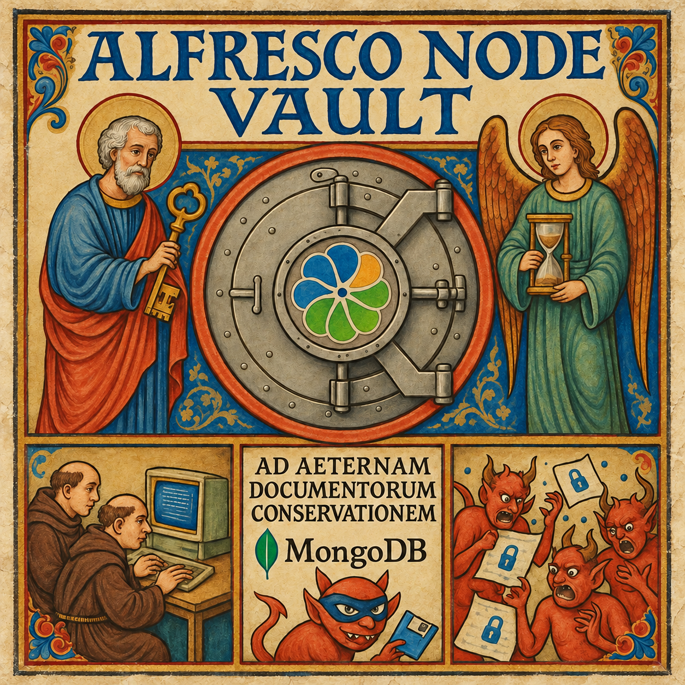

# Alfresco Node Vault



[](https://www.gnu.org/licenses/gpl-3.0)
[](https://saidone75.github.io/alfresco-node-vault/javadoc/)


[](https://sonarcloud.io/summary/new_code?id=saidone75_alfresco-node-vault)
[](https://sonarcloud.io/summary/new_code?id=saidone75_alfresco-node-vault)
[](https://sonarcloud.io/summary/new_code?id=saidone75_alfresco-node-vault)

## The Long-term Document Management Challenge

Over the years, many Alfresco installations inevitably transform into increasingly slow and difficult-to-manage
repositories. The primary cause is the progressive accumulation of millions of nodes that burden the database, slow down
Solr queries, and compromise the overall performance of the system.

This situation is particularly common in organizations where:

- Effective corporate policies for archiving or deleting obsolete documents are missing
- Documents are retained indefinitely due to regulatory or compliance obligations
- Repository sizes grow exponentially year after year
- Users complain about increasingly longer response times in daily operations
- Infrastructure costs continually increase to support ever-larger repositories
- Maintenance operations (backup, indexing, upgrades) become progressively more complex and time-consuming

Repositories with hundreds of millions of nodes can require days for complete reindexing operations, or weeks for
migrations during version upgrades.

Many enterprises find themselves in a difficult position: business units demand that all documents remain accessible,
while IT departments struggle with managing increasingly unresponsive Alfresco instances. The technical debt
accumulates, making each upgrade more complex than the last. Site collections become sluggish, search operations time
out, and what was once a highly efficient ECM solution becomes a burden on daily operations.

## The solution: Alfresco Node Vault

A Spring Boot application designed for long-term storage of Alfresco nodes. Unlike traditional archiving solutions,
Alfresco Node Vault completely removes nodes from Alfresco and its database, freeing resources while maintaining
document accessibility.

The application can archive nodes on-demand through a behavior or using a scheduled job.

Nodes metadata are archived on MongoDB while binaries can be stored either on GridFS or on AWS S3, ensuring efficiency 
and scalability.

The application can also act as a proxy to allow applications using REST APIs to retrieve nodes that no longer exist in
Alfresco, ensuring operational continuity without the need to modify legacy client applications.

Furthermore, documents can also be automatically restored in Alfresco if required.

By implementing Alfresco Node Vault, organizations can:

- Maintain high performance in their active Alfresco repository
- Keep all historical documents accessible when needed
- Significantly reduce backup and maintenance windows
- Lower infrastructure costs by optimizing resource usage
- Simplify upgrade processes by reducing the volume of live data

This approach bridges the gap between complete document purging (often unacceptable for business or compliance reasons)
and the indefinite retention of all documents in the active repository (unsustainable from a performance perspective).

## Key Features
- Lean and elegant code architecture
- Fully FOSS, released under an open license
- Scheduled or on-demand archiving
- MongoDB storage for metadata and audit trail 
- GridFS or S3 storage for binaries
- Optional blockchain node notarization to ensure tamper-proof integrity
- Scheduled and on-demand [integrity sweep](doc/IntegritySweep.md) to continuously verify notarized nodes
- Secure and decoupled design that suits zero trust environments
- Focus on [strong encryption](doc/Encryption.md) option for both content and metadata
- Passwords securely stored in a secret engine
- [REST API](doc/RestApi.md) with Alfresco proxy support and metadata search
- Engineered for flexibility and bespoke integrations
- No installation or changes required on Alfresco
- Prometheus monitoring support for metrics and health checks
- Custom upload and download methods
- Minimal memory footprint
- Robust, enterprise-grade reliability and performance

Pull requests are welcome!

## Architecture


## Application global config

Global configuration is stored in `application.yml` file, the relevant parameters are:

| Parameter/env variable           | Default value                              | Purpose                                                             |
|----------------------------------|--------------------------------------------|---------------------------------------------------------------------|
| ALFRESCO_BASE_PATH               | http://localhost:8080                      | Scheme, host and port of the Alfresco server                        |
| ALFRESCO_USERNAME                | admin                                      | Alfresco user                                                       |
| ALFRESCO_PASSWORD                | admin                                      | Password for the Alfresco user                                      |
| ACTIVE_MQ_URL                    | tcp://localhost:61616                      | ActiveMQ broker URL                                                 |
| MONGODB_URL                      | mongodb://localhost:27017                  | MongoDB connection string                                           |
| S3_ENDPOINT                      | http://localhost:5000                      | S3 object storage endpoint                                          |
| S3_KEY                           | testing                                    | Key for S3 authentication                                           |
| S3_SECRET                        | testing                                    | Secret for S3 authentication                                        |
| EVENT_HANDLER_ENABLED            | false                                      | Event based archive behaviour switch                                |
| ARCHIVING_JOB_ENABLED            | true                                       | Archiving scheduled job switch                                      |
| ARCHIVING_JOB_CRON_EXPRESSION    | 0 0/5 2-6 * * ?                            | Scheduled job cron expression                                       |
| ARCHIVING_JOB_QUERY              | TYPE:'cm:content' AND ASPECT:'anv:archive' | Query for selecting documents to be archived                        |
| VAULT_HASH_ALGORITHM             | SHA-256                                    | Hash stored as metadata on GridFS or S3 object metadata             |
| VAULT_DOUBLE_CHECK               | true                                       | Double check content integrity before removing document on Alfresco |
| VAULT_DELETE_ON_ALFRESCO         | true                                       | Delete document on Alfresco after archiving                         |
| VAULT_DELETE_NODE_API_ENABLED    | false                                      | Enable the delete node API                                          |
| VAULT_AUTH_CACHE_TTL             | 60s                                        | Cache duration of successful API authentications                    |
| VAULT_ENCRYPT_CONTENT            | false                                      | Enable binary content encryption (S3, GridFS)                       |
| VAULT_ENCRYPT_METADATA           | false                                      | Enable node metadata encryption on MongoDB                          |
| VAULT_URL                        | http://localhost:8200                      | Vault secret engine URI                                             |
| VAULT_ENCRYPTION_KV_MOUNT        | secret                                     | Vault secret engine mount path                                      |
| VAULT_ENCRYPTION_SECRET_PATH     | AlfrescoNodeVault                          | Path of encryption secret in Vault secret engine                    |
| VAULT_ENCRYPTION_SECRET_KEY      | anv.secret                                 | Key name of encryption secret                                       |
| AUDIT_TTL_DAYS                   | 60                                         | Retention of audit entries in days                                  |
| NOTARIZATION_ENABLED             | true                                       | Enable notarization service                                         |
| NOTARIZATION_JOB_ENABLED         | false                                      | Document notarization job switch                                    |
| NOTARIZATION_JOB_CRON_EXPRESSION | 0 0/5 * * * ?                              | Cron expression for notarization job                                |
| INTEGRITY_SWEEP_ENABLED          | false                                      | Enable scheduled integrity sweep job                                |
| INTEGRITY_SWEEP_CRON_EXPRESSION  | 0 0 2 * * ?                                | Cron expression for integrity sweep job                             |
| INTEGRITY_SWEEP_BATCH_SIZE       | 200                                        | Number of notarized nodes processed per sweep page                  |
| ETH_RPC_URL                      | http://localhost:8545                      | Ethereum RPC endpoint                                               |
| ETH_PRIVATE_KEY                  | 4f3edf983ac636a65a842ce7c78d9aa7...        | Private key used to sign transactions                               |

## Build

Java and Maven required. See [CONTRIBUTING.md](CONTRIBUTING.md) for setup instructions.

`mvn package -DskipTests -Dlicense.skip=true`

To create a distribution package execute the build script for your platform:

```bash
./build.sh      # Linux / macOS
```

```bat
build.bat       # Windows
```

The script creates an `anv/` directory containing `anv.jar` together with
`config/` and `log/` folders.

## Testing

For a containerized check of archiving, downloading and restoring on S3 and GridFS, with and without encryption,
run `./smoke-tests.sh` (Linux/macOS) or `smoke-tests.bat` (Windows).
These [end-to-end smoke tests](doc/SmokeTest.md) check content hashes and restore retries in an isolated Docker stack.
The launchers stop the smoke stack afterwards; pass `--keep-running` to leave it active for inspection.

For integration tests you can use `vault.(sh|bat)` script to start all needed containers, then

`mvn test`

will run the integration tests, and

`mvn test -Dtests=massive`

will run a load test.

## Docker configuration

The `docker` directory contains a `.env` file used by `docker-compose`.
Copy this file to create your own overrides:

```bash
cp docker/.env docker/.env.local
# edit docker/.env.local and override the desired variables
```

Both `docker-compose` and the helper scripts will automatically pick up
variables from `docker/.env.local` if present.  Use this mechanism to
adjust image versions or swap services when moving from local
development to a production setup. Key variables include:

- `ACS_IMAGE` – Alfresco Content Services image name
- `MONGO_IMAGE` – MongoDB image name
- `HASHICORP_VAULT_IMAGE` – HashiCorp Vault image name

For local development you may rely on the defaults, while in
production you will likely point to hardened images or custom deployments.

## Run

```
cd anv
java -jar anv.jar
```

## REST API

The REST API is versioned under `/api/v1` and requires Basic authentication with Alfresco administrator credentials:

- `/api/v1/vault` to search, retrieve, archive, restore, notarize and re-encrypt nodes and to run integrity sweeps
- `/api/v1/audit` to read the audit trail

Requests to the Alfresco REST API for archived nodes are transparently served by the vault. The OpenAPI documentation
served at `/swagger` is the reference of every endpoint, while [RestApi.md](doc/RestApi.md) covers authentication, the
Alfresco proxy and the common conventions.

## Known limitations

- **Enabling encryption** on a vault that already holds data is supported: existing content and metadata stay
  readable and new nodes are stored encrypted, but existing nodes are not re-encrypted.
- **Disabling encryption** when encrypted data is already stored is not supported: encrypted content would be returned
  as is and encrypted metadata could not be read.
- **Changing the encryption implementation or its parameters** (`impl`, KDF, salt and nonce/IV lengths) is not supported
  when encrypted data is already stored, since they are not recorded with the data and are required for decryption.
  Use [key rotation](doc/Encryption.md#key-rotation) to change the secret.
- The **advanced search** is available only when metadata encryption is disabled.

## Documentation

Javadoc is available at the following address: https://saidone75.github.io/alfresco-node-vault/javadoc/

## License

Copyright (C) 2025-2026 Saidone

Licensed under the GNU General Public License, version 3 or later.
See [LICENSE](LICENSE) for details.
